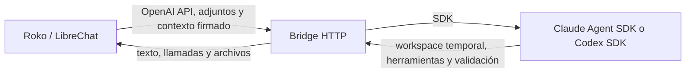

# Roko CLI Bridge

Bridge privado que conecta Roko/LibreChat con Claude Code y Codex mediante una API compatible con OpenAI. Ejecuta los SDK de los proveedores en el servidor, prepara los archivos de cada petición en un workspace aislado y devuelve a Roko los entregables para que los conserve en el historial.

El bridge incluye una herramienta de shell aislada para Claude y el workspace de Codex, además de lectores y conversores para trabajar con documentos, imágenes y medios. No es un modelo, no almacena el historial de chat y no sustituye la persistencia de archivos de Roko.

## Contenido

- [Arquitectura y flujo](#arquitectura-y-flujo)
- [Funciones](#funciones)
- [Archivos y formatos](#archivos-y-formatos)
- [Seguridad y límites](#seguridad-y-límites)
- [Instalación con Docker Compose](#instalación-con-docker-compose)
- [Conectar Roko/LibreChat](#conectar-rokolibrechat)
- [Instalación nativa](#instalación-nativa)
- [Configuración](#configuración)
- [Comprobaciones](#comprobaciones)
- [Estructura del proyecto](#estructura-del-proyecto)
- [Documentación relacionada](#documentación-relacionada)

## Arquitectura y flujo

Roko mantiene usuarios, conversaciones, agentes, memorias, prompts, marcadores y archivos persistentes. El bridge recibe cada petición, valida la identidad firmada por Roko, prepara los adjuntos en una carpeta temporal exclusiva y llama al SDK de Claude o Codex. Los archivos nuevos o editados se validan y se devuelven como bytes codificados en Base64; la integración de Roko los registra con su sistema normal de archivos y los asocia a la respuesta.



Cada petición tiene un workspace nuevo. El bridge **no retoma el directorio de una petición anterior**. Para continuar editando un archivo, Roko conserva el original o el último entregable en el historial y lo vuelve a adjuntar en la siguiente petición. La identidad firmada liga el trabajo a un usuario, tenant, conversación y proveedor; el identificador de conversación no convierte el workspace temporal en almacenamiento permanente.

El bridge usa los SDK de los proveedores; la API HTTP, la autenticación de Roko, el tratamiento de adjuntos, las herramientas de workspace, los límites, la validación de entregables y la adaptación del protocolo OpenAI son código de integración propio.

## Funciones

### Proveedores y modelos virtuales

El endpoint expone estos identificadores estables, que Roko puede presentar en sus selectores:

| Modelo virtual | Proveedor | Perfil |
| --- | --- | --- |
| `claude-max` | Claude Code | Esfuerzo medio |
| `claude-max-fast` | Claude Code | Sonnet, esfuerzo bajo |
| `claude-max-deep` | Claude Code | Opus, esfuerzo alto |
| `gpt-codex` | Codex | Esfuerzo medio |
| `gpt-codex-fast` | Codex | Esfuerzo bajo |
| `gpt-codex-deep` | Codex | Esfuerzo alto |

Los modelos concretos se pueden ajustar en `.env`. El bridge admite el login OAuth de cada CLI; no requiere que ambos proveedores estén configurados. Para usar solo Claude, basta con autenticar Claude. El binario de Codex sigue instalado porque proporciona el sandbox Linux compartido por la herramienta de shell de Claude.

### API y herramientas

- `GET /health`: estado de vida del servicio y lista de capacidades declaradas; no prueba los logins ni el sandbox del kernel.
- `GET /v1/models`: lista los modelos virtuales y requiere la clave del bridge.
- `POST /v1/chat/completions`: peticiones, respuestas y streaming estilo Chat Completions.
- `POST /v1/responses`: entrada, salida, llamadas a funciones, streaming y continuación mediante `previous_response_id` dentro del mismo proceso.
- Relay de herramientas de función: el modelo puede devolver una llamada que Roko ejecuta y cuyo resultado envía en el siguiente turno. Las funciones MCP que LibreChat expone como funciones pueden usar este relay.
- Búsqueda web nativa de Codex, si la petición la activa. Claude puede usar la búsqueda de LibreChat cuando Roko se la ofrece como herramienta de función.

La herramienta interna de Claude `mcp__workspace__execute` se registra en el proceso del bridge. Ejecuta comandos en el workspace temporal mediante el sandbox del sistema; no requiere desplegar otro servidor MCP ni abrir otro puerto. En Docker Linux ejecuta POSIX shell. En Windows nativo usa PowerShell y el sandbox Windows configurado.

Claude también recibe herramientas de lectura y edición de archivos limitadas al workspace. Codex dispone de su shell dentro del mismo límite de workspace. Ambos pueden usar Python y los conversores que se hayan instalado. La herramienta de Claude no habilita Bash sin restricciones ni acceso a la red.

### Parámetros

Se propagan los controles que el CLI puede aplicar: modelo permitido, esfuerzo de razonamiento, resumen de razonamiento, verbosidad y búsqueda web cuando proceda. Los valores por defecto, el perfil del modelo virtual, las opciones firmadas de Roko y los campos explícitos de la petición se combinan con precedencia definida por el bridge.

Las opciones de seguridad y sandbox se deciden en el servidor y no se aceptan como controles del usuario. Parámetros propios de API que el CLI no admite, como una temperatura distinta, top-p o límites de salida, devuelven un error explícito cuando tienen un valor no predeterminado. La interfaz de Roko puede mostrar otros parámetros para endpoints API; eso no significa que este endpoint CLI los admita.

## Archivos y formatos

Los adjuntos llegan con nombre, MIME y bytes Base64 en el cuerpo de la petición. El bridge guarda el original en el workspace y ejecuta lectores administrados; **no ejecuta automáticamente el código que se haya subido**. Según formato y dependencias, prepara texto, metadatos, vistas de imagen o una copia de trabajo convertida para el modelo. Las vistas no sustituyen el original.

| Grupo | Ejemplos de extensiones | Tratamiento disponible |
| --- | --- | --- |
| Imágenes | `.png`, `.jpg`, `.jpeg`, `.webp`, `.gif`, `.tif`, `.tiff`, `.bmp`, `.avif`, `.heic`, `.heif`, `.svg` | Vista para análisis; edición mediante Python y bibliotecas de imagen. Las vistas no conservan necesariamente animación ni metadatos. |
| Documentos Office | `.docx`, `.docm`, `.xlsx`, `.xlsm`, `.pptx`, `.pptm`, `.doc`, `.xls`, `.ppt`, `.xlsb`, `.rtf` | Extracción/validación, LibreOffice para vistas y conversión, Python para edición según formato. La conversión puede alterar diseño o funciones. XLSB no tiene escritor dedicado. |
| OpenDocument | `.odt`, `.ods`, `.odp` | Extracción, vista y edición/conversión con herramientas instaladas. |
| PDF | `.pdf` | Texto y vistas de páginas; OCR de páginas escaneadas si Tesseract está instalado; edición o conversión con herramientas compatibles. PDFs protegidos con contraseña no se preparan. |
| Texto, datos y código | `.txt`, `.md`, `.csv`, `.tsv`, `.json`, `.jsonl`, `.xml`, `.yaml`, `.toml`, `.py`, `.js`, `.ts`, `.sql`, `.ipynb` y otros tipos del mapa MIME | Texto acotado; los notebooks y datos estructurados se validan cuando corresponde. Los scripts subidos solo se ejecutan si el usuario pide explícitamente que se ejecuten. |
| Archivos comprimidos | `.zip`, `.7z`, `.tar`, `.tgz`, `.gz`, `.bz2`, `.xz` | Extracción con límites y comprobaciones contra rutas de escape, enlaces, dispositivos y archivos cifrados. No se extraen recursivamente los archivos comprimidos internos. |
| Audio y vídeo | `.wav`, `.mp3`, `.ogg`, `.flac`, `.aac`, `.opus`, `.m4a`, `.mp4`, `.mov`, `.mkv`, `.webm`, `.avi` | Metadatos con FFprobe y muestras de fotogramas con FFmpeg. La transcripción requiere instalar la opción multimedia y proporcionar un modelo Faster-Whisper local. |
| Otros binarios | Cualquier archivo que Roko acepte y que el bridge pueda transportar | El original puede llegar al workspace, pero el bridge no promete un lector, editor ni validador específico para cada formato. El modelo necesita una herramienta compatible para interpretarlo. |

Límites del bridge: hasta 10 adjuntos por petición y 15 MiB por archivo; el cuerpo HTTP tiene un máximo de 20 MiB. Puede devolver hasta 10 archivos y 15 MiB en total, con máximo de 15 MiB por archivo. Los límites de subida que configure Roko o el navegador también se aplican y pueden ser menores. Base64 aumenta el tamaño transportado.

La validación comprueba que los entregables existan, hayan cambiado, pertenezcan a `outputs/`, no sean enlaces simbólicos, respeten los límites y tengan estructura válida para los formatos con validador. Para tareas de creación o edición, el modelo tiene que declarar los archivos y la respuesta estructurada correspondiente. El bridge da un intento de reparación ante entregables inválidos; si no puede verificarlos, no los anuncia como completados ni envía scripts auxiliares como si fueran documentos finales.

La validación estructural no demuestra que el contenido sea correcto ni que el diseño sea idéntico entre LibreOffice y Microsoft Office. Algunas funciones propietarias, macros, fórmulas y características de medios pueden sufrir cambios en una conversión. El mapa MIME, los lectores y las pruebas del toolkit definen el comportamiento real por formato.

## Seguridad y límites

- Cada petición requiere `Authorization: Bearer <BRIDGE_API_KEY>` y contexto HMAC firmado por Roko con la misma clave. Contexto ausente, caducado o alterado se rechaza antes de iniciar un proveedor.
- El runtime, HOME, cachés, temporales y credenciales de trabajo son privados por petición. Solo se copia el material OAuth requerido; no se copian historiales previos, configuración de usuario, servidores MCP, skills ni instrucciones globales. Al finalizar se elimina el directorio temporal y solo se conserva una renovación válida de credenciales.
- La shell de Claude usa el sandbox nativo con escritura en el workspace, red desactivada, límites de tiempo y salida, cancelación del árbol de procesos y sin fallback a ejecución sin sandbox. Codex también usa su sandbox de workspace: la red está desactivada por defecto y el control de búsqueda web nativa puede habilitarla para esa petición. El ejecutor filtra las variables de entorno heredadas.
- La comprobación de rutas de Claude rechaza rutas exteriores y enlaces simbólicos para lectura y escritura. Las herramientas de archivos y shell solo operan sobre el workspace de la petición.
- El proceso serializa los accesos al fichero OAuth de cada proveedor para evitar conflictos de renovación. El número de peticiones simultáneas y el tiempo máximo se pueden configurar.
- Los logs normales registran categorías de error y diagnósticos acotados. La salida cruda de comandos es opcional con `BRIDGE_DEBUG_PROVIDER=1`; habilítala solo para depuración local.
- El bridge es una frontera de aplicación y no una máquina virtual: los procesos comparten el kernel y la identidad del contenedor/host. En Docker, el sandbox Linux anidado necesita excepciones de capabilities/seccomp/AppArmor limitadas a este servicio. No se usa `privileged`, no se monta el socket Docker y no se monta el filesystem del host.
- Una interrupción eléctrica o terminación forzada puede impedir la limpieza inmediata de una petición. El historial y los archivos de Roko no dependen de ese workspace temporal.

El bridge transporta herramientas de función de LibreChat, pero no implementa los servicios alojados `file_search` ni `code_interpreter` de OpenAI. Si Roko ofrece esas funciones como herramientas y su definición es de tipo función, el proveedor puede pedirlas a Roko mediante el relay. Las capacidades reales dependen también de la configuración de Roko y del modelo elegido.

## Instalación con Docker Compose

Se requiere Docker Engine y Docker Compose. La imagen construye una instalación Linux e instala Node.js, los SDK fijados por el lockfile, Python y las dependencias de edición, LibreOffice, FFmpeg, Tesseract y bubblewrap. Las imágenes objetivo son Linux x64 y ARM64. No hace falta instalar Node ni npm en el host.

1. Copia el proyecto a una carpeta y crea la configuración:

```bash
cp .env.example .env
chmod 600 .env
```

Genera una clave aleatoria de al menos 32 caracteres, introdúcela como `BRIDGE_API_KEY` en el `.env` del bridge y usa la misma cadena como `CLAUDE_BRIDGE_KEY` en el `.env` de Roko. Por ejemplo, Linux incluye `openssl rand -hex 32` para generarla. No pongas la clave en el repositorio.

2. Construye e inicia:

```bash
docker compose up -d --build
docker compose logs --tail=50 bridge
```

3. Inicia sesión en cada proveedor que vayas a usar. Para usar solo Claude, omite los comandos de Codex:

```bash
docker compose exec bridge bridge claude auth login
docker compose exec bridge bridge claude auth status
# Opcional si también usarás Codex:
docker compose exec bridge bridge codex login --device-auth
docker compose exec bridge bridge codex login status
```

Completa el flujo del navegador que indique el CLI. Las credenciales del host no se importan automáticamente; quedan en el volumen Docker de logins. La primera construcción requiere descargar la imagen y dependencias.

Comprueba el workspace y los logins por separado:

```bash
docker compose exec bridge bridge check:workspace
# Solo si usarás Codex:
docker compose exec bridge bridge check:sandbox
docker compose exec bridge bridge health
```

`check:workspace` no necesita iniciar sesión ni llamar a un modelo. Prueba el sandbox usado por Claude y, con Python instalado, crea, edita y valida un DOCX real. `check:sandbox` verifica la ejecución de Codex y requiere su login. `health` es una comprobación HTTP de vida; no certifica credenciales ni sandbox.

Compose conserva credenciales en `logins` y estado de ejecución en `runtime`. `docker compose down` conserva los volúmenes; `docker compose down -v` los borra. No lo uses como un comando de actualización si quieres mantener los logins.

Para la guía completa de integración con Roko, redes, volúmenes y requisitos del sandbox anidado, sigue [DOCKER.md](DOCKER.md).

## Conectar Roko/LibreChat

El bridge y Roko pueden ejecutarse en proyectos Compose separados en el mismo host Docker. El bridge crea la red `roko-cli-bridge`, anuncia el alias `cli-bridge` y publica el puerto del host solo en loopback para diagnósticos locales. Desde otro contenedor en esa red, la URL base es:

```text
http://cli-bridge:4000/v1
```

Añade la red compartida a la API de Roko usando [config/roko-docker-network.patch.yaml](config/roko-docker-network.patch.yaml) como referencia. Conserva las redes y volúmenes existentes de Roko. Configura los endpoints personalizados con los nombres virtuales de arriba y la clave compartida. La URL firmada por el backend de Roko debe coincidir con la URL del bridge configurada.

Hay ejemplos en [config/runtime-config.bridge.yaml](config/runtime-config.bridge.yaml) y [config/librechat.example.yaml](config/librechat.example.yaml). Son fragmentos para integrar en tu configuración efectiva, no reemplazos completos de `librechat.yaml` o `runtime-config.yaml`. No subas claves ni archivos de login al repositorio.

Si Roko se ejecuta en otro host o fuera de Docker, configura `BRIDGE_HOST` para una interfaz alcanzable, restringe el puerto en el firewall y configura la URL de Roko a esa dirección. No expongas el puerto del bridge públicamente sin una capa de red y autenticación adecuadas.

## Instalación nativa

Requiere Node.js 22 o superior. El toolkit de archivos usa Python 3.10 o superior. Linux requiere bubblewrap y las herramientas nativas indicadas en [UBUNTU.md](UBUNTU.md); Windows requiere PowerShell y sandbox nativo de Codex. LibreOffice, FFmpeg y Tesseract son opcionales según las tareas que se necesiten.

```bash
npm ci
npm run setup
npm run setup:files
# Inicia sesión solo en los proveedores que vayas a usar.
npm run check:workspace
npm run check:sandbox
npm start
```

En Windows usa PowerShell, ejecuta los scripts equivalentes de npm y configura las rutas de herramientas en `.env` cuando no estén en `PATH`. El modo elevado del sandbox Windows requiere preparación administrativa; el modo predeterminado usa la opción no elevada. Las dependencias Python y binarios nativos deben instalarse en el mismo sistema donde se ejecutará el bridge. No reutilices `node_modules` ni `runtime-tools` de Windows en Ubuntu o viceversa.

## Configuración

Copia [.env.example](.env.example) a `.env`. Los valores importantes son:

| Variable | Función |
| --- | --- |
| `BRIDGE_API_KEY` | Clave compartida con `CLAUDE_BRIDGE_KEY` en Roko; mínimo 32 caracteres. |
| `BRIDGE_HOST`, `BRIDGE_PORT` | Interfaz y puerto HTTP del servidor. Compose configura el servicio para escuchar dentro del contenedor. |
| `BRIDGE_DATA_DIR` | Raíz de temporales de las peticiones; en Compose es el volumen `/data`. |
| `REQUEST_TIMEOUT_MS` | Tiempo máximo de petición HTTP/proveedor. |
| `MAX_CONCURRENT_REQUESTS` | Peticiones simultáneas aceptadas por proceso. |
| `CLAUDE_MODEL`, `CODEX_MODEL` | Modelo backend por proveedor. |
| `CLAUDE_FAST_MODEL`, `CLAUDE_DEEP_MODEL`, `CODEX_FAST_MODEL`, `CODEX_DEEP_MODEL` | Modelos opcionales para los perfiles rápidos y profundos. |
| `CLAUDE_AUTH_DIR`, `CODEX_AUTH_DIR` | Directorios de login si no se usa la ubicación predeterminada. |
| `CLAUDE_ALLOWED_MODELS`, `CODEX_ALLOWED_MODELS` | Lista explícita de modelos backend admitidos. |
| `BRIDGE_SOFFICE`, `BRIDGE_FFMPEG`, `BRIDGE_FFPROBE`, `BRIDGE_TESSERACT` | Rutas opcionales a ejecutables nativos. Compose instala y resuelve las herramientas Linux dentro de la imagen. |
| `BRIDGE_OCR_LANG` | Idiomas de Tesseract; el ejemplo usa inglés y español. |
| `BRIDGE_WHISPER_MODEL` | Ruta a un modelo Faster-Whisper local previamente provisionado; no se descarga por petición. |
| `BRIDGE_DEBUG_PROVIDER` | Activa diagnósticos crudos acotados; debe permanecer desactivado normalmente. |

El archivo de ejemplo documenta todos los valores disponibles. No pongas secretos en imágenes Docker ni en el control de versiones.

## Comprobaciones

- `npm test`: suite automatizada Node.js.
- `npm run check:workspace`: sandbox compartido de Claude y validación de edición DOCX; no requiere login del proveedor.
- `npm run check:sandbox`: sandbox de Codex; requiere sus credenciales.
- `docker compose exec bridge bridge check:workspace`: equivalente dentro del contenedor.
- `docker compose exec bridge bridge check:sandbox`: verificación Codex dentro del contenedor.
- `docker compose exec bridge bridge health`: consulta de salud HTTP local.
- `powershell -File scripts/Test-Bridge.ps1 -Model claude-max`: prueba HTTP local en Windows para un proveedor autenticado.

El test HTTP con modelo real consume la cuota o recursos del plan del proveedor. Las pruebas unitarias y los checks de sandbox no sustituyen la comprobación del kernel en el servidor donde se despliega.

## Estructura del proyecto

| Ruta | Responsabilidad |
| --- | --- |
| `src/server.mjs` | API HTTP compatible con OpenAI, autenticación, streaming, límites y gestión de peticiones. |
| `src/protocol.mjs` | Normalización Chat Completions/Responses, adjuntos, herramientas y decisiones. |
| `src/providers.mjs` | Selección del SDK, runtime aislado, preparación de adjuntos y limpieza. |
| `src/claude-workspace.mjs`, `src/workspace-executor.mjs` | Herramienta interna de Claude y shell sandboxed compartida. |
| `src/artifacts.mjs`, `src/output-files.mjs` | Contrato, selección, validación y retorno de entregables. |
| `src/file-formats.mjs`, `scripts/file-tools.py` | MIME, lectores, extracción, conversión y validación de archivos. |
| `config/` | Fragmentos de configuración para conectar LibreChat/Roko y un servicio nativo. |
| `docker/`, `Dockerfile`, `compose.yaml` | Construcción y ejecución contenerizada. |
| `test/` | Pruebas de protocolo, proveedores, archivos, aislamiento y sandbox. |

## Documentación relacionada

- [DOCKER.md](DOCKER.md): instalación Docker, red compartida, persistencia y sandbox Linux anidado.
- [UBUNTU.md](UBUNTU.md): instalación nativa en Ubuntu y Windows.
- [SPEC.md](SPEC.md): contrato funcional, autenticación, estados y límites de la API.
- [FORMATS-SPEC.md](FORMATS-SPEC.md): contrato de adjuntos y entregables entre Roko y bridge.
- [src/file-formats.mjs](src/file-formats.mjs) y [scripts/file-tools.py](scripts/file-tools.py): catálogo MIME, lectores, conversión y validación.
- [test/](test/): pruebas automatizadas del protocolo, providers, workspace y formatos.


